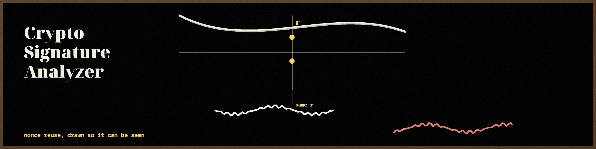
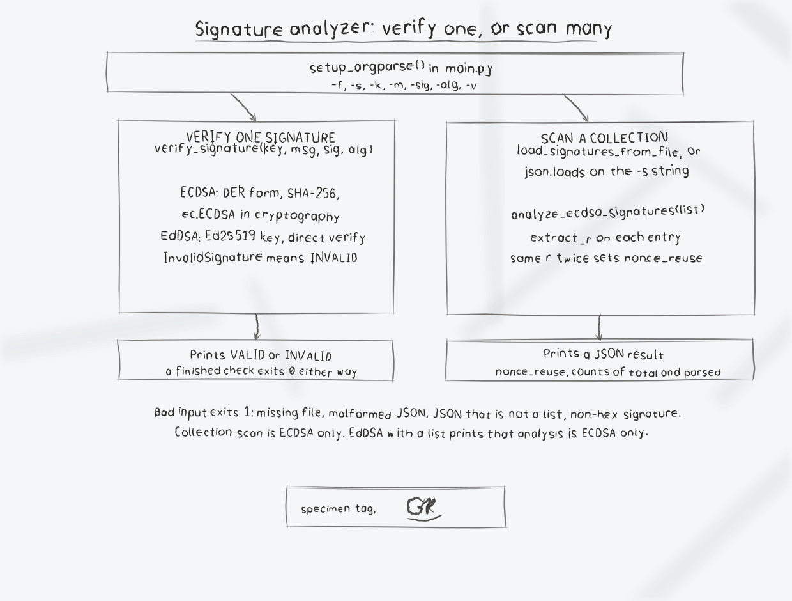

# crypto-signature-analyzer

A command line tool with two jobs: verify one ECDSA or EdDSA signature against a PEM public key, and scan a collection of ECDSA signatures for nonce reuse (the same `r` value appearing in more than one signature, a known key compromise risk).

## Requirements

- Python 3.10 or later
- `cryptography` 41.0.0 or later

## Install

```bash
git clone https://github.com/ShadowGuardAI/crypto-signature-analyzer.git
cd crypto-signature-analyzer
pip install -r requirements.txt
```

## Usage

```
python3 main.py [-h] [-f SIGNATURE_FILE] [-s SIGNATURES_JSON] [-k PUBLIC_KEY]
                [-m MESSAGE] [-sig SIGNATURE] [-alg {ecdsa,eddsa}] [-v]
```

- `-f`, `--file`: path to a JSON file containing a list of signature objects
- `-s`, `--signatures`: JSON string containing a list of signature objects
- `-k`, `--public_key`: path to a PEM encoded public key file
- `-m`, `--message`: message associated with the signature
- `-sig`, `--signature`: signature to verify, hex encoded
- `-alg`, `--algorithm`: `ecdsa` (default) or `eddsa`
- `-v`, `--verbose`: enable verbose output
- `-h`: show help and exit

### Verify a single signature

All three of `-k`, `-m`, and `-sig` are required. ECDSA verification assumes DER encoded signatures and SHA-256. EdDSA verification works with Ed25519 keys.

```bash
python3 main.py -k public.pem -m "hello world" -sig <hex signature> -alg ecdsa
# prints: Signature is VALID.
python3 main.py -k public.pem -m "tampered" -sig <hex signature> -alg ecdsa
# prints: Signature is INVALID.
```

### Scan a collection for ECDSA nonce reuse

Each list item must have a `signature` field containing a hex encoded signature. Both DER encoded signatures and raw `r||s` concatenations are accepted, and the `r` value is extracted from either format. Unparseable entries are skipped and do not count toward the result.

```bash
python3 main.py -f signatures.json
python3 main.py -s '[{"signature": "aaaa1111"}, {"signature": "aaaa2222"}]'
```

Output for the second example (both signatures share `r` = 0xaaaa):

```json
{
    "nonce_reuse": true,
    "signature_count": 2,
    "parsed_count": 2
}
```

With no input the tool prints `No signatures provided for analysis. Use -f/--file or -s/--signatures.` and exits 1. The exit code is 1 for bad input generally (a missing file, malformed JSON, a JSON value that is not a list of signatures, or a non-hex signature); a completed verification exits 0 whether the signature is valid or not, and a completed scan exits 0.

## Limitations

- Collection analysis is available only for ECDSA. With `-alg eddsa` and a signature list it prints `Analysis only available for ECDSA signatures.`
- It detects exact `r` reuse only. It does not check for biased nonces, weak randomness short of reuse, or malleability, despite those being related ECDSA risks.
- ECDSA verification always uses SHA-256; other hash choices are not configurable.

## License

Copyright (c) ShadowGuardAI

## Diagrams and maps

I drew the tool out in [crypto-signature-analyzer-Visuals](crypto-signature-analyzer-Visuals/): an architecture diagram, a data-flow diagram for the scan, a flowchart of main(), and a product map, with the written product map, statistics with citations, and the roadmap in [VISUAL.md](crypto-signature-analyzer-Visuals/VISUAL.md). Every sheet also ships as a PNG photograph of the paper page beside its SVG.


