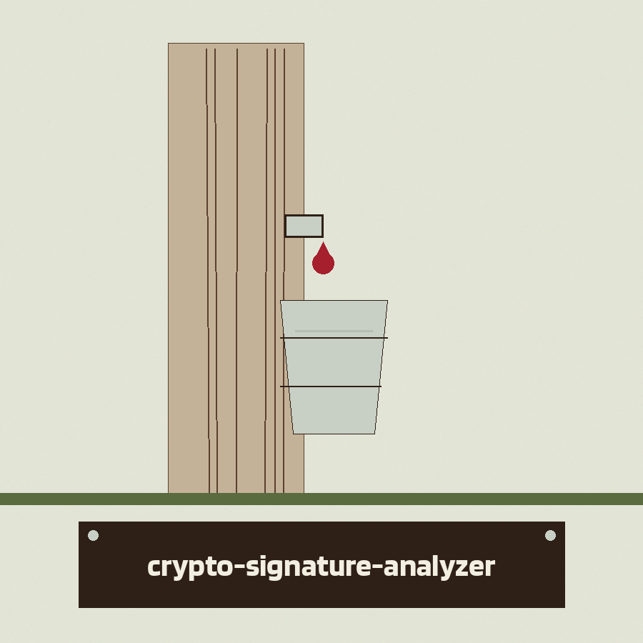
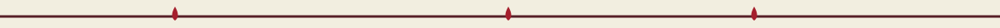
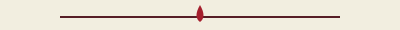

# crypto-signature-analyzer

Title block: a tally board nailed to the trunk. The name above is chalked in Blinker, moss on a bark brown board, ruled beneath, with one small tin bucket drawn beside this first heading only. The remaining headings keep the run book form without the bucket.






# crypto-signature-analyzer

A command line tool with two jobs: verify one ECDSA or EdDSA signature against a PEM public key, and scan a collection of ECDSA signatures for nonce reuse (the same `r` value appearing in more than one signature, a known key compromise risk).



## Requirements

- Python 3.10 or later
- `cryptography` 41.0.0 or later

> Flagged slat, berry red nail at the corner: an invalid result is a finished check and exits 0, while a key that cannot be loaded, or a key that does not match the chosen algorithm, means no check took place at all; the tool says verification could not be performed and exits 1.


## Install

```bash
git clone https://github.com/ShadowGuard-AI/crypto-signature-analyzer.git
cd crypto-signature-analyzer
pip install -r requirements.txt
```


## Usage

```
python3 main.py [-h] [-f SIGNATURE_FILE] [-s SIGNATURES_JSON] [-k PUBLIC_KEY]
                [-m MESSAGE] [-sig SIGNATURE] [-alg {ecdsa,eddsa}] [-v]
```

- `-f`, `--file`: path to a JSON file containing a list of signature objects
- `-s`, `--signatures`: JSON string containing a list of signature objects
- `-k`, `--public_key`: path to a PEM encoded public key file
- `-m`, `--message`: message associated with the signature
- `-sig`, `--signature`: signature to verify, hex encoded
- `-alg`, `--algorithm`: `ecdsa` (default) or `eddsa`
- `-v`, `--verbose`: enable verbose output
- `-h`: show help and exit

### Verify a single signature

All three of `-k`, `-m`, and `-sig` are required. ECDSA verification assumes DER encoded signatures and SHA-256. EdDSA verification works with Ed25519 keys.

```bash
python3 main.py -k public.pem -m "hello world" -sig <hex signature> -alg ecdsa
# prints: Signature is VALID.
python3 main.py -k public.pem -m "tampered" -sig <hex signature> -alg ecdsa
# prints: Signature is INVALID.
```

`Signature is INVALID.` means the signature was checked and did not verify, and that result exits 0. If the public key cannot be loaded or does not match the chosen algorithm, no verification takes place: the tool prints an error line stating that signature verification could not be performed and exits 1, instead of reporting the signature as invalid.

### Scan a collection for ECDSA nonce reuse

Each list item must have a `signature` field containing a hex encoded signature. Both DER encoded signatures and raw `r||s` concatenations are accepted, and the `r` value is extracted from either format. Unparseable entries are skipped and do not count toward the result.

```bash
python3 main.py -f signatures.json
python3 main.py -s '[{"signature": "aaaa1111"}, {"signature": "aaaa2222"}]'
```

Output for the second example (both signatures share `r` = 0xaaaa):

```json
{
    "nonce_reuse": true,
    "signature_count": 2,
    "parsed_count": 2
}
```

The no reuse result is only meaningful when `parsed_count` is greater than zero. If a non-empty collection is scanned and no signature in it can be parsed, the tool prints `Error: No signature in the collection could be parsed.` and exits 1, and it does not print a no reuse verdict for that scan.

With no input the tool prints `No signatures provided for analysis. Use -f/--file or -s/--signatures.` and exits 1. The exit code is 1 for bad input generally (a missing file, malformed JSON, a JSON value that is not a list of signatures, or a non-hex signature) and for a public key that cannot be loaded or does not match the chosen algorithm; a completed verification exits 0 whether the signature is valid or not, and a completed scan that parsed at least one signature exits 0.


## Limitations

- Collection analysis is available only for ECDSA. With `-alg eddsa` and a signature list it prints `Analysis only available for ECDSA signatures.`
- It detects exact `r` reuse only. It does not check for biased nonces, weak randomness short of reuse, or malleability, despite those being related ECDSA risks.
- ECDSA verification always uses SHA-256; other hash choices are not configurable.

> Flagged slat, berry red nail at the corner: cross key caution. The scan compares r values only; the public key and message inside each collection entry are never read, so the same r under two different keys is reported as reuse, and a positive result is a prompt to check whether the entries share a key.

> Flagged slat, berry red nail at the corner: malformed DER note. A signature value that fails DER decoding can still yield an r from its first half of bytes when its length is even, and that number then takes part in the comparison as if cleanly parsed.


## License

Copyright (c) ShadowGuardAI

> Flagged slat, berry red nail at the corner: the licence line above is shown as printed and is flagged in place. It names the organisation in an unhyphenated form, while the separate LICENSE file holds the MIT License. The two stand side by side without reconciliation.


## Diagrams and maps

I drew the tool out in [crypto-signature-analyzer-Visuals](crypto-signature-analyzer-Visuals/): an architecture diagram, a data-flow diagram for the scan, a flowchart of main(), and a product map, with the written product map, statistics with citations, and the roadmap in [VISUAL.md](crypto-signature-analyzer-Visuals/VISUAL.md). Every sheet also ships as a PNG photograph of the paper page beside its SVG.


Run book notes, entered plainly at the close. The single verification branch wins outright: when key, message, and signature are all present, any collection already loaded from a file is never used; the two jobs cannot run together. The parser help for the file argument claims each entry should include signature, message, and public key keys; the scan reads the signature field alone, and the README states that one field correctly. The day closes as the story closes: the run tallied, the buckets emptied into the evaporator, the board wiped clean for tomorrow.
